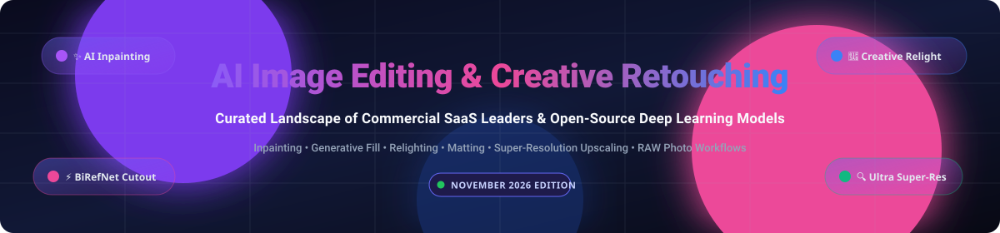

  

# 🎨 Awesome AI Image Editing & Creative Retouching Ecosystem 🚀

   

  <strong>A curated index of cutting-edge AI photo editing SaaS tools, foundational deep learning models, and open-source retouching studios.</strong> 
  <em>Object Removal • Hair-Level Alpha Matting • Ambient Relighting • Generative Fill • Super-Resolution Upscaling • Facial Restoration</em>

  <strong>Last updated: November 2026</strong>

---

## 📖 Table of Contents

- [🌐 Sector Overview & Market Dynamics](#-sector-overview--market-dynamics)
- [💼 Commercial SaaS & Hosted Platforms](#-commercial-saas--hosted-platforms)
- [🔓 Open-Source GitHub Projects](#-open-source-github-projects)
- [📈 Star History](#-star-history)
- [💖 Support & Sponsorship](#-support--sponsorship)
- [🤝 How to Contribute](#-how-to-contribute)
- [⚖️ Disclaimer](#-disclaimer)

---

## 🌐 Sector Overview & Market Dynamics

The global AI image editing and computational retouching market is valued at approximately **$1.85 billion in 2026** and is projected to surpass **$5.4 billion by 2032**, demonstrating an aggressive compound annual growth rate (CAGR) of ~19.5%. Driven by explosive enterprise e-commerce demand, social creator economies, and real-time generative diffusion pipelines, the sector features a **moderately fragmented landscape with strong bi-modal concentration**:

* **Incumbent Giants & Platform Ecosystems (Concentrated Core)**: Adobe, Canva, and Jasper control massive global distribution and enterprise licensing footprints, embedding AI generative workflows (Firefly, Magic Studio) directly into standardized design workflows.
* **Specialized Point-Solution Disruptors (Fragmented Long-Tail)**: Independent innovators (e.g., Photoroom, Topaz Labs, Skylum) and a rapidly evolving open-source community (ComfyUI, BiRefNet, IOPaint, IC-Light) fiercely compete on niche fidelity—achieving industry benchmarks in sub-pixel hair matting, studio-grade relighting, and high-frequency super-resolution restoration before incumbents can integrate them.

---

## 💼 Commercial SaaS & Hosted Platforms

The table below catalogs leading commercial SaaS solutions, ranked in descending order of **Company Scale (Valuation / Market Capitalization / Annual Revenue)**:

| Platform / Tool 🛠️ | Company Scale (Valuation / Revenue) 🏢 | Key Features & Strengths ⚡ | Starting Tier Pricing 🏷️ | Free Tier Limits 🎁 |
| :--- | :--- | :--- | :--- | :--- |
| **[Adobe Photoshop Web (Firefly)](https://adobe.com)** | **$185B+ Market Cap** (Public: NASDAQ: ADBE; ~$21.5B ARR) | Browser-native Photoshop featuring Firefly Generative Fill, Generative Expand, Remove Tool, and multi-layer cloud PSD workflows. | **$9.99/mo** (Photoshop on Web / Photography Plan) | **7-day free trial** with 25 monthly Generative Credits. No permanent free tier. |
| **[Canva (Magic Studio)](https://canva.com)** | **$32B Valuation** (~$2.5B ARR; 190M+ monthly users) | Visual design ecosystem integrating Magic Eraser, Magic Edit, Magic Expand, Background Remover, and AI brand mockups. | **$15.00/user/mo** ($120/yr for Canva Pro) | **Free forever plan** with basic editing, 5GB cloud storage, and up to 50 lifetime Magic Studio AI uses. |
| **[Photoroom](https://photoroom.com)** | **$1.25B Valuation** ($225M Series B; ~$85M ARR) | Mobile and web product photography studio specializing in automated background removal, studio relighting, and batch cutouts. | **$12.99/mo** (or $89.99/year for Photoroom Pro) | **Free forever plan** with standard resolution downloads, Photoroom watermark, and 250 AI cutout exports. |
| **[Clipdrop (Jasper)](https://clipdrop.co)** | **$1.2B Valuation** (Acquired by Jasper AI; Jasper peak val $1.5B) | Rapid AI visual suite offering instant ambient relighting (Relight), cleanup inpainting, background remover, and SDXL generation. | **$13.00/mo** (or $96/year Pro Subscription) | **Free forever plan** with standard resolution web exports (max 1024px) and 100 free AI cleanup/relight ops/day. |
| **[Luminar Neo (Skylum)](https://skylum.com)** | **~$50M - $80M Valuation** (Estimated ~$20M - $30M ARR) | Desktop & cloud creative photo editor tailored for photographers: Relight AI, Sky Replacement AI, GenErase, and RAW processing. | **$9.95/mo** (or $79/year subscription / $199 perpetual license) | **7-day full-feature free trial** upon signup. No permanent free tier. |
| **[Topaz Photo AI](https://topazlabs.com)** | **~$40M - $70M Valuation** (Estimated ~$15M - $25M ARR) | Specialized computer vision desktop suite acclaimed for Autopilot face recovery, motion deblur, and high-frequency super-resolution. | **$199.00 one-time purchase** (includes 1 year of continuous feature updates) | **30-day free trial** with full feature evaluation and watermarked image exports. |
| **[Fotor](https://fotor.com)** | **~$30M - $50M Valuation** (Estimated ~$12M - $18M ARR) | Online visual suite featuring 1-click AI photo enhancer, skin retouching, background generator, and batch e-commerce cutout tools. | **$8.99/mo** (or $39.99/year for Fotor Pro) | **Free forever plan** with standard editing, basic filters, watermarked exports, and 5 complimentary AI credits on signup. |
| **[Pixlr](https://pixlr.com)** | **~$20M - $40M Valuation** (Part of INMAGINE Group; ~$10M ARR) | Browser-based Photoshop alternative featuring AI generative fill, object removal, background cutout, and responsive design templates. | **$1.99/mo** (Plus tier) / **$7.99/mo** (Premium tier) | **Free forever plan** with basic photo adjustments, standard definition saving, and 3 AI tool credits per day. |
| **[BeFunky](https://befunky.com)** | **~$15M - $30M Valuation** (Bootstrapped/Private; ~$8M ARR) | Creative web photo editor providing AI portrait retouching, A.I. Cutout, background eraser, smart HDR, and collage generators. | **$14.99/mo** (or $59.88/year [$4.99/mo billed annually] for BeFunky Plus) | **Free forever plan** with essential editing tools and 125 photo effects; AI tools locked to Plus. |
| **[Photopea](https://photopea.com)** | **~$10M - $25M Valuation** (Solo-founder profitable entity; ~$3M - $5M ARR) | Full browser-native raster and vector editor supporting PSD, XCF, and Sketch files with local smart layers and Magic Cut tools. | **$5.00/mo** (or $9/quarter / $40/year for Ad-Free Premium) | **Free forever plan** with 100% of editing and AI Magic Cut tools unlocked (ad-supported, 30-step history limit). |

---

## 🔓 Open-Source GitHub Projects

The following repositories provide self-hosted AI inpainting studios, neural background matting networks, super-resolution pipelines, and RAW editors. Repositories are ranked in descending order by **GitHub Star Count**:

| Repository 📦 | GitHub Stars ⭐ | Primary Focus & Architecture 🔍 | License 📜 |
| :--- | :--- | :--- | :--- |
| **[AUTOMATIC1111/stable-diffusion-webui](https://github.com/AUTOMATIC1111/stable-diffusion-webui)** |  | Definitive web UI for Stable Diffusion and SDXL featuring deep inpainting, outpainting, Sketch-to-Image, and ControlNet. | `AGPL-3.0` |
| **[comfyanonymous/ComfyUI](https://github.com/comfyanonymous/ComfyUI)** |  | Modular graph-based visual pipeline for chaining SAM 2 segmentation, regional inpainting, IC-Light relighting, and multi-stage upscaling. | `GPL-3.0` |
| **[upscayl/upscayl](https://github.com/upscayl/upscayl)** |  | Open-source cross-platform desktop AI image upscaler built on `ncnn-vulkan` running hardware-accelerated super-resolution without CUDA. | `AGPL-3.0` |
| **[TencentARC/GFPGAN](https://github.com/TencentARC/GFPGAN)** |  | Blind face restoration algorithm leveraging facial component degradations and generative priors for restoring archival and blurred portraits. | `Apache-2.0` |
| **[xinntao/Real-ESRGAN](https://github.com/xinntao/Real-ESRGAN)** |  | Practical restoration algorithm and super-resolution engine for real-world degraded photos, digital paintings, and high-ratio upscaling. | `BSD-3-Clause` |
| **[huggingface/diffusers](https://github.com/huggingface/diffusers)** |  | Foundational Python library for state-of-the-art diffusion pipelines, inpainting models, ControlNet adapters, and image-to-image editing. | `Apache-2.0` |
| **[lllyasviel/ControlNet](https://github.com/lllyasviel/ControlNet)** |  | Neural network structure to add spatial conditioning controls (depth, canny edge, normal map, openpose) to image editing diffusion models. | `Apache-2.0` |
| **[invoke-ai/InvokeAI](https://github.com/invoke-ai/InvokeAI)** |  | Creative engine featuring an infinite Unified Canvas for non-destructive multi-layer inpainting, outpainting, and Control Layers. | `Apache-2.0` |
| **[black-forest-labs/flux](https://github.com/black-forest-labs/flux)** |  | 12B rectified flow transformer models (FLUX.1 Fill & FLUX.1 Kontext) powering cutting-edge prompt-guided inpainting and object replacement. | `Apache-2.0` / Non-Commercial |
| **[danielgatis/rembg](https://github.com/danielgatis/rembg)** |  | CLI, Python package, and Docker microservice for neural background removal with support for BiRefNet, U2Net, and IS-Net ONNX models. | `MIT` |
| **[Sanster/IOPaint](https://github.com/Sanster/IOPaint)** |  | Self-hosted image inpainting and outpainting web studio powered by LaMa, PowerPaint, BrushNet, AnyText, and FLUX models. | `Apache-2.0` |
| **[facebookresearch/sam2](https://github.com/facebookresearch/sam2)** |  | Segment Anything Model 2 for zero-shot real-time point-and-click object segmentation and pixel-precise alpha masks. | `Apache-2.0` |
| **[jantic/DeOldify](https://github.com/jantic/DeOldify)** |  | Deep learning framework for photorealistic colorization and historical restoration of vintage black-and-white photography. | `MIT` |
| **[sczhou/CodeFormer](https://github.com/sczhou/CodeFormer)** |  | Robust blind face restoration algorithm for addressing old photos with heavy compression artifacts, face blur, and scratches. | `S-Lab Non-Commercial` |
| **[ImageMagick/ImageMagick](https://github.com/ImageMagick/ImageMagick)** |  | Industrial-strength raster image processing engine supporting batch resizing, color profiling, alpha blending, and headless pipelines. | `ImageMagick License` |
| **[darktable-org/darktable](https://github.com/darktable-org/darktable)** |  | Open-source photography workflow application and non-destructive RAW developer with parametric masking and color reconstruction. | `GPL-3.0` |
| **[libvips/libvips](https://github.com/libvips/libvips)** |  | Extremely fast low-memory demand-driven image processing library for ultra-high-resolution tiling, compositing, and export pipelines. | `LGPL-2.1` |
| **[Acly/krita-ai-diffusion](https://github.com/Acly/krita-ai-diffusion)** |  | ComfyUI plugin embedded into Krita for live interactive painting, regional layer inpainting, generative fill, and upscaling. | `GPL-3.0` |
| **[advimman/lama](https://github.com/advimman/lama)** |  | Large Mask Inpainting using Fast Fourier Convolutions (FFCs) for high-resolution artifact-free object removal. | `Apache-2.0` |
| **[lllyasviel/IC-Light](https://github.com/lllyasviel/IC-Light)** |  | Illumination-manipulation diffusion model enabling precision foreground portrait and product relighting matching ambient environments. | `Apache-2.0` |
| **[timothybrooks/instruct-pix2pix](https://github.com/timothybrooks/instruct-pix2pix)** |  | Natural language instruction-guided image editing without requiring user masks or per-pixel conditioning. | `MIT` |
| **[GNOME/gimp](https://github.com/GNOME/gimp)** |  | Cross-platform image manipulation program extensible via Python plugins, G'MIC filters, and local deep-learning inference backends. | `GPL-3.0` |
| **[Fanghua-Yu/SUPIR](https://github.com/Fanghua-Yu/SUPIR)** |  | Scaling-up photo-realistic image restoration with multimodal text-guidance, restoring fine hair, textile, and skin textures. | `Apache-2.0` |
| **[ZhengPeng7/BiRefNet](https://github.com/ZhengPeng7/BiRefNet)** |  | State-of-the-art Bilateral Reference Network for high-resolution dichotomous image segmentation and sub-pixel edge matting. | `MIT` |
| **[VectorSpaceLab/OmniGen](https://github.com/VectorSpaceLab/OmniGen)** |  | Unified multi-modal generation and image-to-image editing model supporting instruction-based object insertion, replacement, and pose transfer. | `MIT` |
| **[Beep6581/RawTherapee](https://github.com/Beep6581/RawTherapee)** |  | Advanced non-destructive 32-bit float RAW photo processing engine with demosaicing, micro-contrast enhancement, and CIECAM02 color. | `GPL-3.0` |
| **[piddnad/DDColor](https://github.com/piddnad/DDColor)** |  | Dual-decoder colorization network utilizing pixel and query decoders for historical black-and-white landscape and portrait restoration. | `Apache-2.0` |
| **[GreycLab/gmic](https://github.com/GreycLab/gmic)** |  | Comprehensive GREYC's Magic for Image Computing framework providing 500+ filters for denoising, color grading, and inpainting. | `CeCILL` |

---

## 📈 Star History

---

## 💖 Support & Sponsorship

If you find this curated ecosystem valuable for your research, projects, or creative retouching workflows, please consider giving it a **Star ⭐**, forking the repository, and sharing it with the developer and creative communities!

Your support helps keep this index continually updated with the newest breakthrough models and commercial tools. You can also sponsor ongoing open-source curation and development:

  

---

## 🤝 How to Contribute

1. Fork this repository.
2. Add your suggested SaaS platform or open-source repository following the established table structure. Ensure exact pricing/free-tier specifics and accurate GitHub stargazer badges are included.
3. Submit a Pull Request with a clear description of the project's utility and differentiation.

---

## ⚖️ Disclaimer

*All trademarks, logos, and brand names are the property of their respective owners. Mention of commercial products or open-source projects does not constitute an endorsement.*
